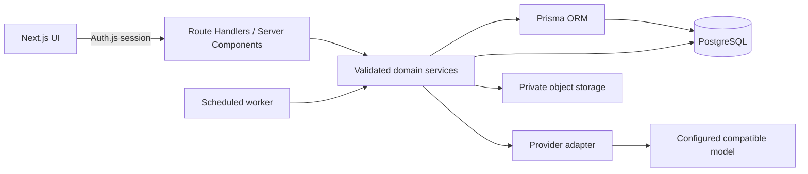

# FinanceFlow architecture

## 1. System architecture

FinanceFlow is a TypeScript Next.js App Router application. Server Components render authenticated screens; client components handle interactive forms and charts. Route Handlers expose a versioned-by-resource REST surface. Domain logic lives in services and validates all input with Zod. Prisma is the only database access layer and PostgreSQL is the source of truth. The initial deployment target is one Node.js web service plus managed PostgreSQL and compatible object storage. A separately runnable worker claims recurring occurrences and notifications with database-backed idempotency; a cron trigger can invoke its authenticated job endpoint.



Authentication uses Auth.js with a database-backed session, bcrypt password verification, and an optional Google provider activated only when credentials are configured. Credentials registration and login are supported; verification and reset tokens are single-use, hashed at rest, and delivered through a configurable mail adapter. Production must configure HTTPS, secrets, and email delivery before enabling those flows.

## 2. Database ER diagram

```mermaid
erDiagram
  User ||--o{ Account : connects
  User ||--o{ Session : owns
  User ||--o{ VerificationToken : verifies
  User ||--o{ Category : defines
  User ||--o{ Transaction : records
  User ||--o{ Budget : plans
  User ||--o{ RecurringTransaction : schedules
  User ||--o{ Receipt : uploads
  User ||--o{ SavingsGoal : tracks
  User ||--o{ Notification : receives
  User ||--o{ AIInsight : gets
  User ||--o{ ChatMessage : sends
  User ||--o{ NotificationPreference : configures
  Category ||--o{ Transaction : classifies
  Category ||--o{ Budget : limits
  Category ||--o{ RecurringTransaction : classifies
  Receipt o|--o{ Transaction : attached_to
  RecurringTransaction ||--o{ RecurringOccurrence : executes
  Transaction ||--o| RecurringOccurrence : creates
  User { string id PK; string email UK; string currency; string timezone }
  Category { string id PK; string userId FK; string name; enum type }
  Transaction { string id PK; string userId FK; string categoryId FK; decimal amount; enum type; datetime transactionDate }
  Budget { string id PK; string userId FK; string categoryId FK; decimal amountLimit; int month; int year }
  Receipt { string id PK; string userId FK; string storageKey; decimal totalAmount }
  RecurringTransaction { string id PK; string userId FK; string categoryId FK; decimal amount; string frequency }
  RecurringOccurrence { string id PK; string recurringTransactionId FK; datetime scheduledFor; string transactionId FK }
  SavingsGoal { string id PK; string userId FK; decimal targetAmount; decimal currentAmount }
  Notification { string id PK; string userId FK; string type; boolean isRead }
  AIInsight { string id PK; string userId FK; string insightType; datetime periodStart }
  ChatMessage { string id PK; string userId FK; string role; string content }
```

All monetary fields use PostgreSQL `Decimal`; arithmetic and aggregation stay decimal-safe. A currency code is stored per account and category/budget/transaction ownership is enforced in services and relational constraints. Budgets are unique by user, category, month, and year; recurring occurrences are unique by rule and scheduled instant. Child rows cascade only with their owner; receipt references are optional and constrained to that same owner at service boundaries.

## 3. Prisma schema

The canonical complete schema is [prisma/schema.prisma](prisma/schema.prisma). It contains Auth.js adapter tables and the ten product entities, plus notification preferences and recurring execution records needed for reliable operation. PostgreSQL constraints/indexes cover identity, ownership lookups, date filtering, and idempotency.

## 4. Project structure

```text
prisma/{schema.prisma,seed.ts,migrations/}
src/app/
  (auth)/{login,register,forgot-password}/
  (dashboard)/{overview,transactions,budgets,analytics,recurring,receipts,savings,assistant,settings}/
  api/{auth,transactions,budgets,analytics,receipts,recurring,insights,assistant,savings}/
src/components/{ui,dashboard,charts,transactions,budgets,receipts,assistant}/
src/lib/{auth.ts,prisma.ts,validations/,utils/}
src/services/{transaction,budget,analytics,ai,receipt,recurring}.service.ts
src/types/  src/hooks/  tests/
```

Route handlers are thin: authenticate, parse, call service, map errors. Services own authorization-scoped queries and transactions. UI components never access Prisma or secrets.

## 5. API specification

All endpoints require an authenticated session except registration, login, password-reset initiation/completion, and provider callbacks. JSON errors have `{ error: { code, message, details? } }`; list responses are paginated with `{ data, page, pageSize, total }`.

| Method | Path | Purpose |
| --- | --- | --- |
| POST | `/api/auth/register` | Create account, default categories, verification request |
| POST | `/api/auth/forgot-password` | Request single-use reset email |
| POST | `/api/auth/reset-password` | Consume reset token and update password |
| GET, POST | `/api/transactions` | List with filters/page; create transaction |
| GET, PATCH, DELETE | `/api/transactions/:id` | Read/update/delete owned transaction |
| GET, POST | `/api/categories` | List/create owned categories |
| PATCH, DELETE | `/api/categories/:id` | Update/delete owned category |
| GET, POST | `/api/budgets` | List/create budgets |
| PATCH, DELETE | `/api/budgets/:id` | Update/delete budget |
| GET | `/api/health` | Database readiness check without internal detail |
| GET | `/api/analytics?from=&to=` | Server-calculated summary and chart series |
| POST | `/api/receipts/scan` | Validate/upload/inspect receipt; never saves a transaction |
| GET, POST | `/api/recurring` | List/create recurring rules |
| PATCH, DELETE | `/api/recurring/:id` | Pause/edit/delete owned rule |
| POST | `/api/jobs/recurring` | Secret-protected idempotent scheduled execution |
| GET, POST | `/api/savings` | List/create goals |
| PATCH, DELETE | `/api/savings/:id` | Update/delete owned goal |
| GET, POST | `/api/insights` | Read/generate cached period insights |
| GET, POST | `/api/assistant` | Read chat history/ask a grounded financial question |
| GET | `/api/export/transactions?from=&to=&format=csv` | Export owned transactions |
| GET, PATCH | `/api/settings` | Read/update profile, currency, timezone, preferences |
| GET, PATCH | `/api/notifications` | List/mark notifications read |

Mutations validate UUIDs, enum values, dates, ranges, limits and category ownership. Lists cap page sizes. Sensitive endpoints have per-user and per-IP rate limits.

## 6. UI/UX plan

Use a responsive two-column shell with a compact top bar, notifications, persistent light/dark theme toggle, and a spacious content canvas. A neutral slate surface, deep navy text, emerald income/savings, coral expense, and amber warnings provide consistent meaning. Inter is the UI typeface; tabular numerals and Indian locale formatting keep amounts scannable. Overview prioritizes balance, monthly income/expenses, budget utilization, cash-flow history, category distribution, recent transactions, and actionable insight cards. Forms support keyboard use, validation, clear empty/loading/error states, confirmation for destructive actions, and accessible labels. Light/dark themes use design tokens. Motion is limited to short state transitions; charts use Recharts with textual summaries for accessibility.

## 7. AI integration

An `AIProvider` boundary supports OpenAI-compatible chat and vision endpoints selected only on the server through environment configuration. The financial assistant first classifies a question into a fixed set of intents, then calls allowlisted Prisma service functions scoped to the session user. The application computes all amounts, percentages, comparisons, and date ranges itself using decimal arithmetic; the model receives only minimized aggregates and produces validated narrative text. It cannot execute SQL or call arbitrary tools. Insights are cached by user/type/period and labeled informational. Receipt images are size/type/signature checked, privately stored, and sent to a vision provider only when configured; the returned Zod-validated extraction is a draft for explicit user review. Provider absence yields an honest configuration error, never fabricated content.

## 8. Security architecture

Passwords use bcrypt with a work factor appropriate to deployment; sessions are HTTP-only, secure in production, same-site cookies. Every query is filtered by authenticated `userId`; every referenced category/receipt/rule is ownership checked. Zod validates untrusted inputs and uploads, Prisma parameterizes all database operations, output rendering escapes text, and mutation endpoints enforce origin/CSRF protections and rate limits. Response headers include CSP, HSTS in production, frame/content-type/referrer protections. Secrets stay server-side. Logs omit credentials, receipt contents, and transaction notes. Receipt object keys are private and signed URLs short-lived. Data deletion, backup encryption, retention, and regional privacy requirements must be set for the target deployment.

## 9. Roadmap and key challenges

1. **Foundation (now):** app scaffold, schema/migrations/seed, credentials/Google-ready auth, account setup, transaction CRUD, dashboard shell.
2. **Dashboard and budgets:** real aggregate endpoints/charts, category management, budget alerts and date filters.
3. **AI:** provider adapters, grounded insights/chat, secure receipt scan review flow.
4. **Advanced:** idempotent recurring worker, savings, notifications, CSV/PDF reports.
5. **Release:** automated tests, security review, production build, deployment/runbook.

Key challenges are decimal correctness across APIs/UI, timezone-safe period boundaries, reliable job retries, private receipt storage, auth email delivery, and AI grounding. We use decimal strings at API boundaries, explicit account timezone for date windows, unique occurrence keys plus transactions for job idempotency, provider/storage adapters, and deterministic calculations before model narration. External credentials (PostgreSQL, Google OAuth, mail, AI, storage) are configuration prerequisites, not simulated successes.
